<div align="center">

<br>

# VLTN Tone Studio

A desktop editor and librarian for the Valeton GP-5 and GP-50.<br>
Shape tones live, sort and back up all 100 slots, and bring in NAM captures from TONE3000.

<br>

<a href="https://github.com/grzmol/VLTN-Tone-Studio/releases/latest"></a>
<a href="https://github.com/grzmol/VLTN-Tone-Studio/releases"></a>
<a href="https://github.com/grzmol/VLTN-Tone-Studio/actions/workflows/release.yml"></a>
<a href="https://github.com/grzmol/VLTN-Tone-Studio/commits"></a>


<br>

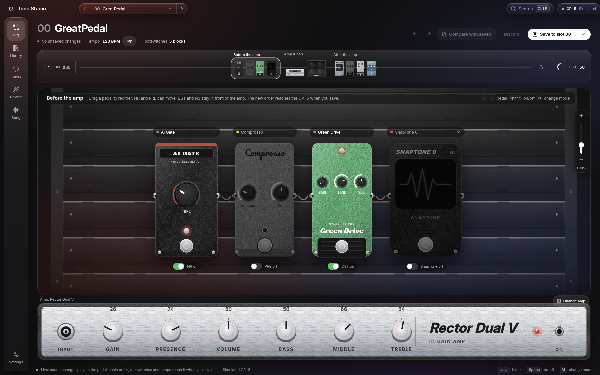

<br>
<br>

### Download v0.4.0

<a href="https://github.com/grzmol/VLTN-Tone-Studio/releases/download/v0.4.0/vltn-tone-studio-0.4.0-x64.exe"></a>
<a href="https://github.com/grzmol/VLTN-Tone-Studio/releases/download/v0.4.0/vltn-tone-studio-0.4.0-arm64.dmg"></a>
<a href="https://github.com/grzmol/VLTN-Tone-Studio/releases/download/v0.4.0/vltn-tone-studio-0.4.0-x64.dmg"></a>
<br>
<a href="https://github.com/grzmol/VLTN-Tone-Studio/releases/download/v0.4.0/vltn-tone-studio-0.4.0-x86_64.AppImage"></a>
<a href="https://github.com/grzmol/VLTN-Tone-Studio/releases/download/v0.4.0/vltn-tone-studio-0.4.0-amd64.deb"></a>

<sub>Also runs in Chrome & Edge &nbsp;·&nbsp; <a href="https://github.com/grzmol/VLTN-Tone-Studio/releases">All versions and release notes</a></sub>

**Like it?** A ⭐ on [GitHub](https://github.com/grzmol/VLTN-Tone-Studio) helps other Valeton players find Tone Studio.<br>
Bugs and ideas are welcome in [Issues](https://github.com/grzmol/VLTN-Tone-Studio/issues).

<a href="https://github.com/grzmol/VLTN-Tone-Studio/stargazers"></a>

<br>

</div>

---

<div align="center">

<br>

## Every knob. Live.

Turn a knob on screen and you hear it on the pedal right away.<br>
Nothing is saved until you say so. Compare with the saved preset, undo, and drag pedals into a new order.

<br>

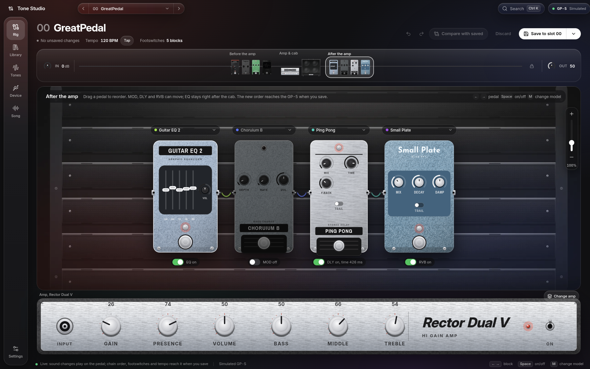

<br>
<br>

</div>

---

<div align="center">

<br>

## Hear it before you pick it.

Every model is listed with the real gear it's based on.<br>
Use the arrow keys to move through them and hear each one on the pedal. Press Enter to keep one, or Esc to go back.

<br>

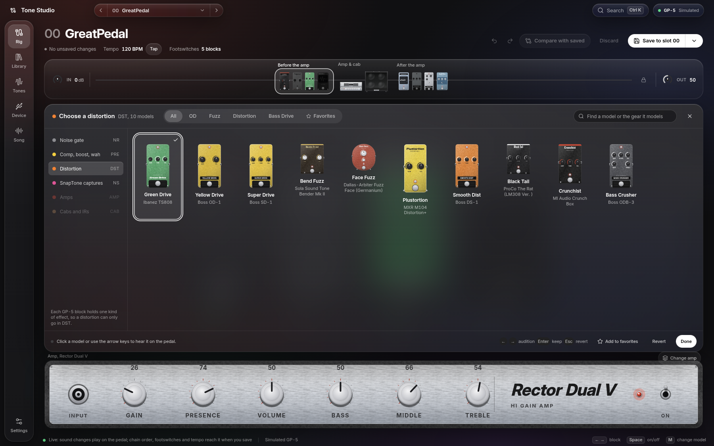

<br>
<br>

</div>

---

<div align="center">

<br>

## The amp, then the cab.

Pick an amp and a cabinet, or load one of your 20 User IR slots.<br>
The amp's controls stay in the strip at the bottom of the screen.

<br>

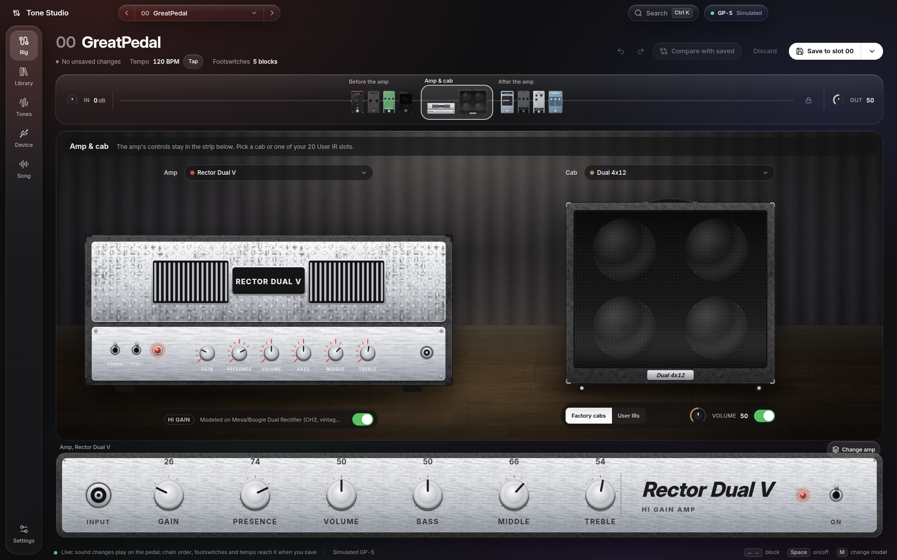

<br>
<br>

</div>

---

<div align="center">

<br>

## A hundred presets. All in one view.

See the whole signal chain of every slot as a row of colours.<br>
Select several slots, then copy, move, swap or export them at once. Import `.prst` files, open backups, and get back any preset that was overwritten.

<br>

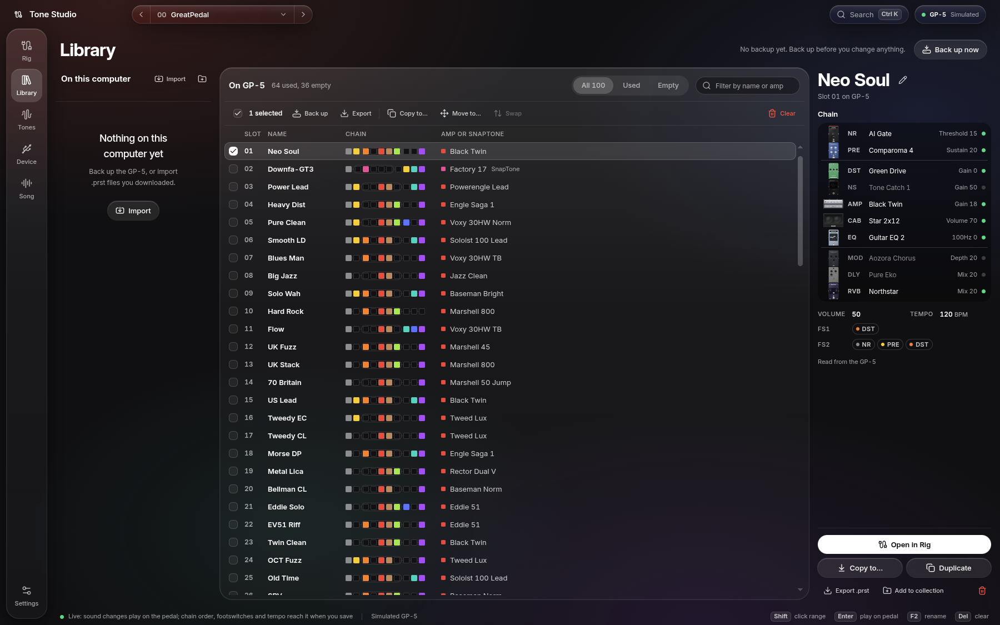

<br>
<br>

</div>

---

<div align="center">

<br>

## Just type.

Press <kbd>Ctrl</kbd> <kbd>K</kbd> and start typing.<br>
Search presets, models, and every preset that uses a model, all from one box.

<br>

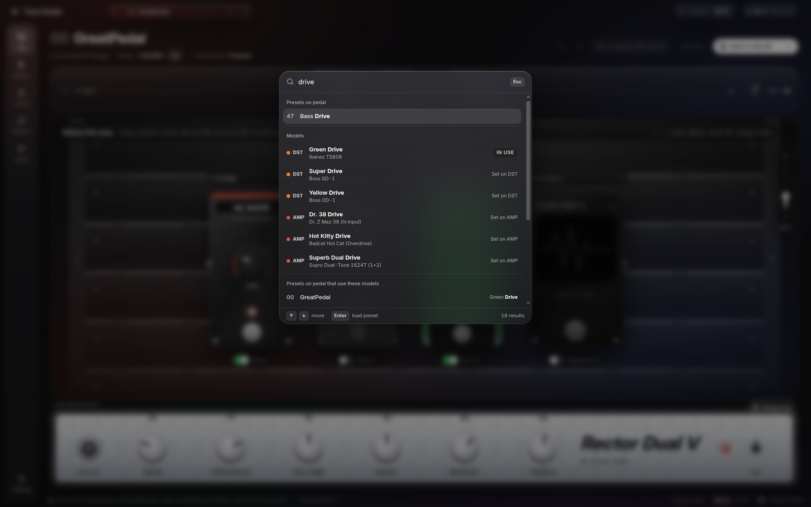

<br>
<br>

</div>

---

<div align="center">

<br>

## Your pedal, looked after.

Change the pedal's global settings. Back up all 100 slots with one click, and restore any backup.<br>
Diagnostics check each step of the connection to the pedal, and a live MIDI monitor shows every message.

<br>

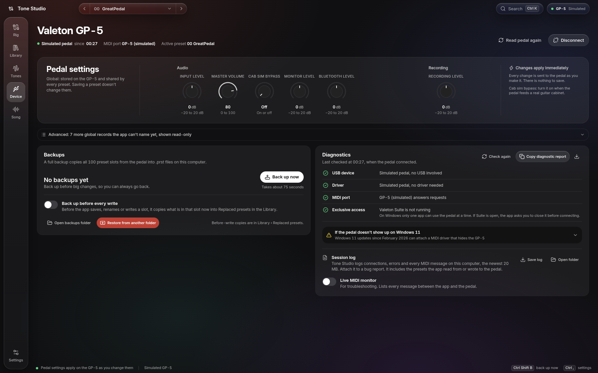

<br>
<br>

</div>

---

<div align="center">

<br>

## Tones from TONE3000.

Browse and download NAM captures and IRs from TONE3000, and see which slots on your pedal already hold them.

<br>

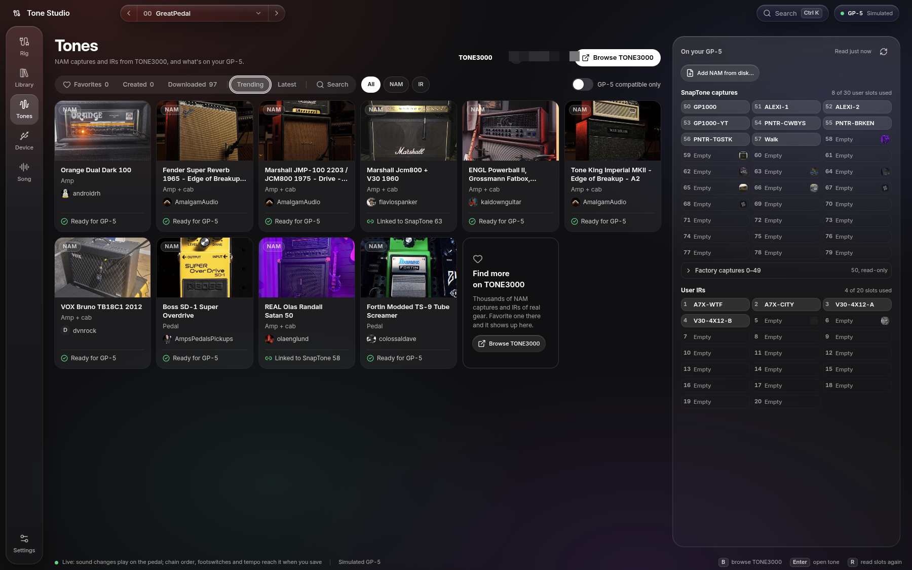

<br>
<br>

A NAM capture, A1 or A2, becomes a SnapTone right in the app and goes straight to a user slot over USB.<br>
IRs go straight to one of the 20 User IR slots. No Valeton Suite needed.

<br>


<br>
<br>

The capture editor plays your guitar through a capture, using the input of your audio interface.<br>
Compare its sizes, match levels, and shape it before it goes to the pedal.

<br>


<br>
<br>

</div>

---

<div align="center">

<br>

## From a song to a tone.

Drop a song and split it into drums, bass, guitar, piano, vocals and the rest, on your own computer.<br>
Mute or solo any of them and export them as WAV.

<br>

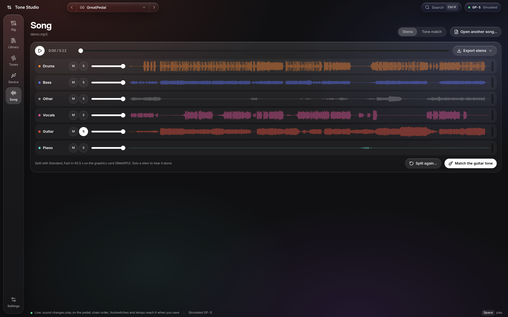

<br>
<br>

Tone Match listens to the guitar alone and proposes a preset for your GP-5 or GP-50 that you can play on the pedal right away.

<br>

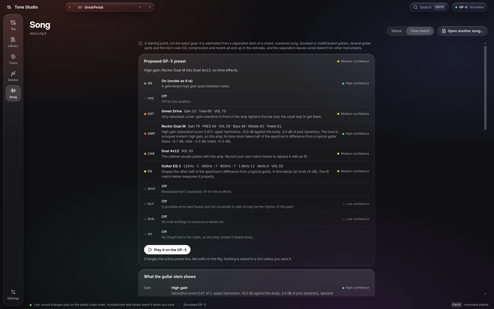

<br>
<br>

It shows what it heard: gain, echo, reverb, level, and the guitar's spectrum against a typical guitar.<br>
Record yourself through the pedal and it designs a cabinet IR that brings your tone closer to the song's.

<br>

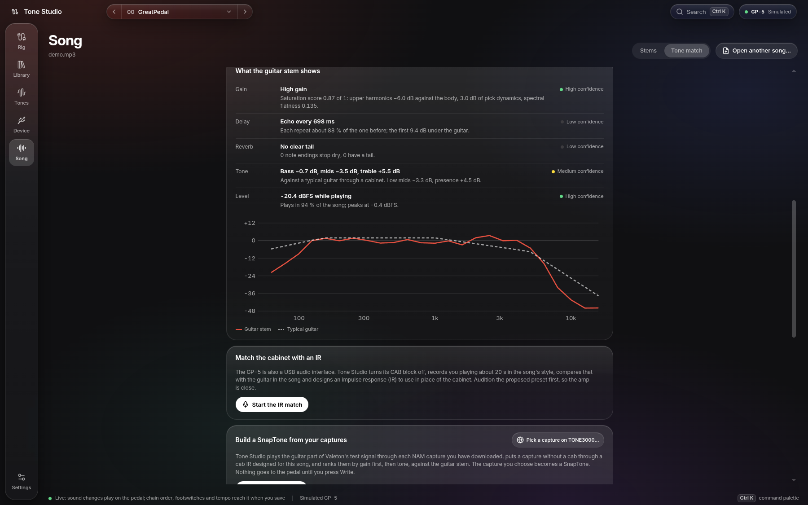

<br>
<br>

</div>

---

<div align="center">

<br>

## Devices.

</div>

<br>

| | GP-5 | GP-50 | GP-200 · 200R · 200X | GP-200LT | GP-200JR |
|---|:---:|:---:|:---:|:---:|:---:|
| Recognised over USB | ✅ | ✅ | 🧪 | 🧪 | 🧪 |
| Live editing | ✅ | 🧪 | 🗓️ | 🗓️ | 🗓️ |
| Preset library | ✅ 100 slots | 🧪 100 slots | 🗓️ 256 slots | 🗓️ 256 slots | 🗓️ 255 slots |
| Backups and restore | ✅ | 🧪 | 🗓️ | 🗓️ | 🗓️ |
| `.prst` import and export | ✅ | 🧪 | 🗓️ | 🗓️ | 🗓️ |
| Pedal settings | ✅ | 🧪 | 🗓️ | 🗓️ | 🗓️ |
| Footswitch assignment and chain order | ✅ | 🧪¹ | 🗓️ CTRL 1–8 | 🗓️ | 🗓️ |
| Tempo and tap tempo | 🧪 | 🧪¹ | 🗓️ | 🗓️ | 🗓️ |
| Expression pedal settings per preset | — | 🧪¹ | 🗓️ | 🗓️ | 🗓️ |
| SnapTones (NAM) over USB | ✅ 30 slots | 🧪 30 slots | 🗓️ 10 slots | ❔ | ❔ |
| User IRs over USB | ✅ 20 slots | 🧪 20 slots | 🗓️ 20 slots | 🗓️ 20 slots | 🗓️ 20 slots |
| Tone Match | ✅ | 🧪 | 🗓️ | 🗓️ | 🗓️ |
| Simulated pedal (no hardware needed) | ✅ `?mock` | ✅ `?mock=gp50` | 🗓️ | 🗓️ | 🗓️ |
| Tested on a real unit by this project | ✅ | not yet | not yet | not yet | not yet |

✅ works &nbsp;·&nbsp; 🧪 works in the app, not yet tried on a real unit &nbsp;·&nbsp; 🗓️ planned &nbsp;·&nbsp; ❔ not known yet whether the pedal has it &nbsp;·&nbsp; — the pedal doesn't have it

¹ On a real GP-50, live footswitch and order changes, live tempo, expression pedal settings and the pedal's own copy, move and clear are known only from Valeton Suite's code. They sit behind **Settings › GP-50 extras (experimental)** until they're tried on a GP-50; with it off, footswitches, order and tempo reach the pedal when you save. The simulator always has them.

The app recognises the connected model by itself. `.prst` files of the GP-5 and GP-50 can be written to either: a GP-5 preset goes onto a GP-50 unchanged; a GP-50 preset loses its GP-50-only models, its expression pedal settings and synced Time/Rate values on a GP-5, and the app lists what changes before writing.

The GP-200 family speaks a different protocol from the GP-5 and GP-50. Its support is being built: a GP-200, GP-200LT or GP-200JR already connects, but its screens still use the GP-5's layout, and the LT and JR stay read-only until one has been tested. Its effect names and knob ranges will come from Valeton's GP-200 editor on your computer, since Tone Studio can't ship that list.

<br>

---

<div align="center">

<br>

## Under the hood.

</div>

<br>

| | |
|---|---|
| **Connection** | WebMIDI with SysEx, straight to the pedal over USB |
| **App** | Electron 43, React 19, TypeScript, Tailwind CSS v4 |
| **Presets** | Reads and writes `.prst` files, byte for byte |
| **SnapTones and IRs** | Converts NAM A1 and A2 captures the way Valeton Suite does, then uploads them and cab IRs over USB |
| **Safety** | Backs up a slot automatically before it's overwritten |
| **Packages** | `.dmg`, NSIS installer, AppImage and `.deb` |

<br>

<div align="center">

## Get started.

</div>

```bash
cd app
npm install
npm run dev        # desktop app
npm run web        # in the browser at http://localhost:5790
```

Download links for the current version are [at the top](#download-v040); older versions are on the [Releases](https://github.com/grzmol/VLTN-Tone-Studio/releases) page. When a new version is out, the app asks at launch whether to download and install it. The Windows installer and the AppImage update in place. On macOS and with the `.deb`, the app opens the release page for you to download it.

No pedal? Open `http://localhost:5790/?mock` for a simulated GP-5, or `?mock=gp50` for a simulated GP-50, each loaded with a full 100-slot backup.

All commands and the code layout are in [`app/README.md`](app/README.md).

<div align="center">

<sub>VLTN Tone Studio is an independent project. It is not affiliated with or endorsed by Valeton.</sub>

<br>
<br>

</div>
