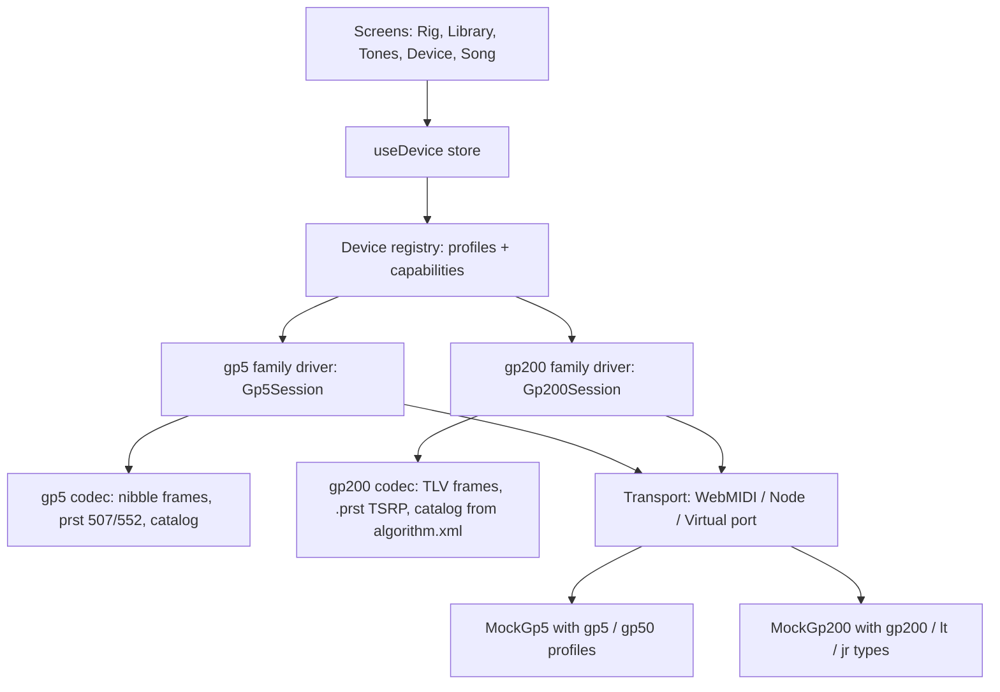

# Plan: full GP-50 and GP-200 support

Status 2026-10-11. Inputs: the 15 repositories of [github.com/topics/valeton](https://github.com/topics/valeton) (plus a dozen GP-200 projects outside the topic), static reverse engineering of Valeton Suite 2.1.0 and the official GP-200 editor 1.8.0 with [REA](https://github.com/morluto/rea) + Ghidra and blutter, and the GP-50 1.1.0 / GP-200 1.8.0 firmware images. The detailed protocol knowledge lives in the agent skills `valeton-gp50` and `valeton-gp200` (`.claude/skills/`, local); this file is the engineering plan.

## 1. Where we are
| device | protocol family | app today | confidence |
|---|---|---|---|
| GP-5 | HT nibble SysEx (CRC-8, ACK per frame) | full support, hardware-verified | HW |
| GP-50 | same family as the GP-5 | editor, library, backups, SnapTone, User IR through the GP-5 code path | reads, writes and PC select HW-verified by others; everything else RE (Suite sends the same bytes) — not yet run on a GP-50 by us |
| GP-200 / R / X / LT / JR | `F0 21 25 7E "GP-2"`, TLV records, no checksum, no ACK | none | protocol decoded from the vendor editor (RE) and cross-checked with OSS hardware work; nothing run by us |

### Defects the RE found in the current GP-50 path
| # | defect | where | fix (phase 1) |
|---|---|---|---|
| D1 | GP-50 globals use the GP-5 record map: (2,4) is *BT REC* not monitor, (3,4) is monitor, (5,4) is *REC Mode R* not BT level | `gp5/lib/protocol.mjs` `GLOBALS`, `screens/device/PedalSettings.tsx` | per-model globals table |
| D2 | negative global values sent as `v & 0xff` instead of int32 | `encode.setGlobal` | int32 LE (identical for 0–127) |
| D3 | GP-5 → GP-50 conversion forces the footswitch state bytes to `05 05` | `prst.mjs convertPrst` | `06` when the switch has blocks and all are on, else `05` |
| D4 | SnapTone names keep punctuation and spaces (Suite's per-character regex); Suite 2.1.0's import helper additionally runs `sanitizeFileName`, which drops punctuation and whitespace | `snaptone.mjs sanitizeSnapToneName` | apply both steps like Suite; confirm with a name read-back (`0x24`) |
| D5 | Ampage Classic *MidFreq* shown as kHz; it is an index (220 Hz…3 kHz) | `catalog-data.mjs` | enum labels (also AC Sim Mode, Toucher Mode, Voxy TB Char) |
| D6 | GP-50 select goes CC#0 first, which only the manual documents; Suite selects with `11 43` and Program Change is hardware-proven on the GP-50 | `session.mjs selectPreset` | per-model select order: `11 43` (verified by `0x43`), PC as fallback |
| D7 | the GP-50 model echo `0x47` (`s16 s16 s32`, 8 bytes) is not recognised (decoder needs 3 × u32) and `12 1B 02/03/04` (preset names / SnapTone / IR lists changed) only trigger a preset resync, not a list re-read | `protocol.mjs decodeMessage`, `state/device.ts` | decode both layouts; re-read `0x40` / `0x24` / `0x20` |

## 2. Target architecture
One registry of device profiles and one driver interface; each protocol family brings its own codec, session and simulator. The GP-5 family keeps its code unchanged behind an adapter.

- `DeviceKey = "gp5" | "gp50" | "gp200" | "gp200lt" | "gp200jr"`, defined once and shared by main, preload and renderer (replaces `PedalModel`, `PEDAL_NAMES`, both `DEVICE_KEYS`).
- `DeviceProfile` (pure data, importable in main): name, family, USB PID, port pattern, slot count and slot label (`07` vs `12-C`), blocks, params per block, footswitch/CTRL count, SnapTone/IR capability (slot counts, sample count), globals table, name length, `.prst` sniffing.
- `DeviceDriver` (renderer): identify, sync, select, read/write/save/rename, live edits, globals, uploads, events. `Gp5Session` already fits; `Gp200Session` is new.
- The UI reads geometry from the profile instead of constants (100 slots, 10 blocks, 80 SnapTones, 20 IRs are hard-coded in ~40 places; list in the app device map).
- Cross-family conversion is refused with a clear message until a model-mapping table exists.

## 3. Phases
Each phase ends green on `npm run typecheck`, `npm test`, `npm run test:toolkit`, and with a smoke run in `?mock=<device>`.

### Phase 1 — GP-50 correctness (small, ships first)
D1–D7 above, plus: GP-50 CC map (master volume, EXP, tempo CC73/74, CTRL 2, looper, drum; drop CC22/23/29/30 for the GP-50), read `12 45` at connect, handle the GP-50 `0x47` echo layout (`s16 s16 s32`). Acceptance: GP-50 globals screen shows the GP-50 menu; codec tests with the RE vectors; conversion tests for the state bytes.

### Phase 2 — GP-50 feature completeness (behind "experimental on GP-50" until phase 7)
| feature | protocol | UI |
|---|---|---|
| EXP per patch | `0x42` records `0x2003–0x200A` | EXP panel in the Rig (target module/param, min/max, VOL Pre/Post) |
| BPM and tap | `0x42` `0x2002`, tap computed in the app | tempo control in the header |
| Sync params | f32 index 0–10 when Sync = 1 | Time/Rate knobs switch to note divisions; re-read after toggle |
| footswitch assignment | `11 4D <mask1><mask2>`, fallback full write | ≤ 3 blocks per switch, disjoint |
| chain reorder | `11 44 order[10]`, fallback full write | drag in the Pedalboard |
| preset management | delete `0x46`, paste `0x4B`, move `0x5A`, export read `12 4F` | Library actions; destructive ones confirm and back up first |
| globals | GP-50 table incl. FS3/FS4 functions, MIDI source/channels, display, Auto CAB, DC power (1.1.0) | Device screen |

### Phase 3 — Simulators (both families; see §4)
GP-50 profile inside `MockGp5`, new `MockGp200`, native fixture banks, virtual MIDI port for both, replay of captured JSONL sessions.

### Phase 4 — Multi-device refactor (no behaviour change for GP-5/GP-50)
Registry and `DeviceKey` union; replace every `gp5`/`gp50` binary branch and silent coercion to `gp5` (`main/tone3000/records.ts`, `files-store.ts`, `host/web/files.ts`, `state/device.ts`, library/tones/tonematch stores, command palette); USB detection reads PIDs from the registry (today a GP-200 on USB is reported as "firmware update mode"); slot labels and counts from the profile; backups `gp200-YYYY-MM-DD`; `.prst` sniffing per family. Acceptance: all existing tests green, GP-5 and GP-50 mocks behave identically, a new test runs the store over every registry key.

### Phase 5 — GP-200 toolkit (`gp200-toolkit`, mirrors `gp5-toolkit`)
| module | content | tests |
|---|---|---|
| `protocol.mjs` | frame/deframe (14-bit LEN/OFF, 183-B chunks, unmasked low nibble on RX), TLV encode/walk, record builders, danger-frame guard | 59 RE vectors (independently re-encoded) |
| `prst.mjs` | 1168-B image ⇄ `.prst` (`TSRP`/`2-PG`/`MRAP`, Σ u32 BE), 4- and 8-CTRL files, volatile-byte mask | round trip of MIT-licensed `.prst` files |
| `catalog.mjs` + generator | build the catalog from the user's installed `algorithm.xml` (param index = XML `ID`, Combox `TrueID`, sync binding) | generator against a synthetic XML |
| `session.mjs` | connect FSM (0x2001 → SOFTWARE_STATE → 0x1007), sync with 1 s × 3 resends, stored and edit-buffer reads, edits with `{0, cur}` header, save, full write + double read-back verify, globals, IR (1024 × int32, Σ) and SnapTone (VTSI, IR2 cut to 1024 taps) uploads with `0x100B`/`0x1014` results, pacing (≥ 10 ms per frame, 1 s after multi-chunk) | against `MockGp200` |
| `mock-device.mjs` | `MockGp200` | session tests, fault injection |
| CLI | `gp200.mjs info / names / backup / write / monitor` | — |

### Phase 6 — GP-200 in the app
Library with 256 (JR 255) slots and bank labels `01-A`…`64-D`; Rig with 11 blocks (WAH, VOL, FX-loop send/return nodes, all movable); EXP1 A/B + EXP2 (9 slots), 8 CTRL masks, 3 Quick-Access knobs; globals incl. global EQ; User IR (20 × 1024 samples) and SnapTone (5 AMP + 5 DST) from TONE3000 and local files, reusing the SnapTone converter with the 1024-tap cap; Tone Match model mapping for the GP-200 catalog (or hidden until mapped); LT/JR differences from the profile (footswitches, MIDI labels, slot count). Updater-mode detection (SOFTWARE_STATE 0, PID `002B`) shows "update with Valeton's tool" and sends nothing.

### Phase 7 — Hardware verification and release gates
Run the checklists in `valeton-gp50/hardware-verification.md` and `valeton-gp200/hardware-verification.md` (read-only first, writes on scratch slots, everything logged as fixtures). A feature leaves "experimental" only after its round trip passes on hardware on the current firmware; CHANGELOG and README support table updated per release. Firmware gating: GP-50 1.0.5 vs 1.1.0, GP-200 by the 0x1007 version.

## 4. Simulators
Goal: the whole app, tests and demos run without a pedal, and the simulators fail the same way the pedals do.

| | GP-50 (`MockGp5`, profile `gp50`) | GP-200 (`MockGp200`, new) |
|---|---|---|
| bank | native GP-50 bank from MIT presets + generated ones (not Valeton's factory bank) | generated patches + MIT `.prst`; 256/255 slots by type |
| replies | 511-B `0x41` in 27 frames, `12 45`, `12 4F` export, GP-50 globals, `0x42` records | 0x2001 `{1,type}`, SOFTWARE_STATE, pushed 0x1007, stored vs edit-buffer reads in 185-B chunks, name tables, `0x100B`/`0x1014`, `0x2003` echo |
| commands | all GP-5 commands + `0x42` EXP, `0x4D`, `0x44`, `0x46`, `0x4B`, `0x5A` | all records in `valeton-gp200/protocol.md`; full write applied only when complete and addressed in the TLVs |
| select | `11 43`, CC#0, Program Change | `0x1008 {0,slot}`, CC0 + PC (polarity switch until verified) |
| notifications | `12 43 s16`, echoes; `12 1B` behind a flag | `0x1008` on patch change, echoes of globals, `0x1011` dirty |
| faults | `wedgeOnOverrun`, `selectRaceMs`, `dropFrames`, pacing violations | deaf window after writes, 0x9F verify glitch, ALSA-style fragmentation, CMD `0x03` flush, a host that waits for ACKs is flagged |
| safety | `0x3F`/`0x33`/firmware frames never answered | firmware jump / updater / destructive globals refused and recorded |

Shared pieces: one `?mock=<deviceKey>` switch in the app (`gp5`, `gp50`, `gp200`, `gp200lt`, `gp200jr`), Device-screen "Simulate a …" buttons from the registry, a virtual MIDI port script per family so other apps (and Valeton's editor, for captures) can talk to the simulator, and replay of hardware JSONL captures as regression tests once phase 7 produces them. The specs: `valeton-gp50/simulator.md`, `valeton-gp200/simulator.md`.

## 5. Risks
| risk | mitigation |
|---|---|
| GP-200 has no ACK; a bad full write silently loses a patch | back up all slots first, scratch slots, double read-back with the volatile mask, retry, restore |
| GP-200 CC0 polarity unknown | select via SysEx `0x1008` only until verified |
| Chromium on Linux fragments 380-byte SysEx (ALSA sequencer) | test early; Node transport as a fallback for writes |
| GP-50 RE comes from mobile Suite (BLE) | firmware has one parser for USB and BT; still HW-gate every write path |
| LT / JR identification and compatibility unverified | profile flags; read-only until a unit is tested |
| Vendor data (catalog XML/JSON, factory presets, firmware) | generate from the user's installation at runtime; never commit it |
| GPL sources (phash, kabir0st, donpark2000…) | facts only, no code; our codec is written from the RE notes and vectors |

## 6. Tooling used
`morluto/rea` 6.4.0 (MIT) as a persistent MCP session over a local bridge (`.claude/skills/gp5-reverse-engineering/tools/`), Ghidra 12.1.4, blutter (Dart 3.12.1), Python for assets and firmware. Workflow: `gp5-reverse-engineering` → "Static RE of the vendor apps".
